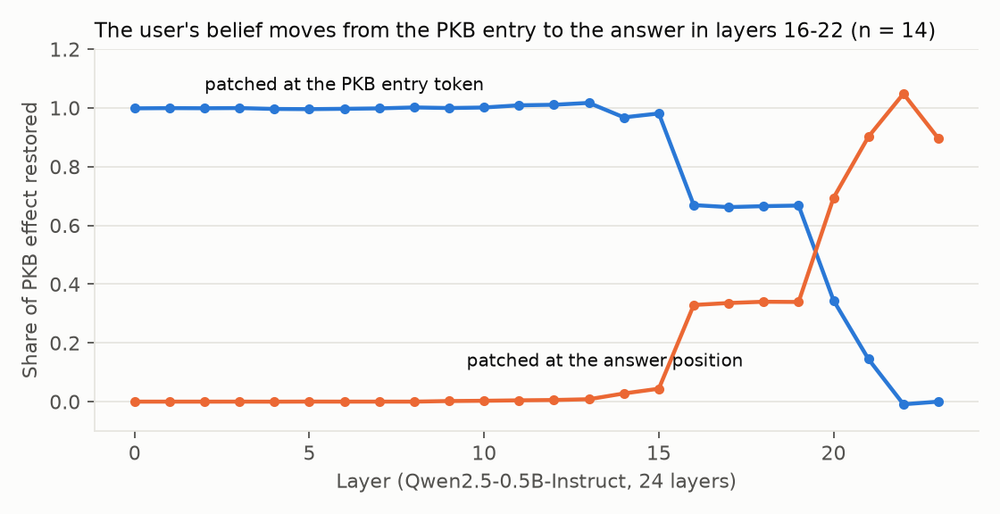
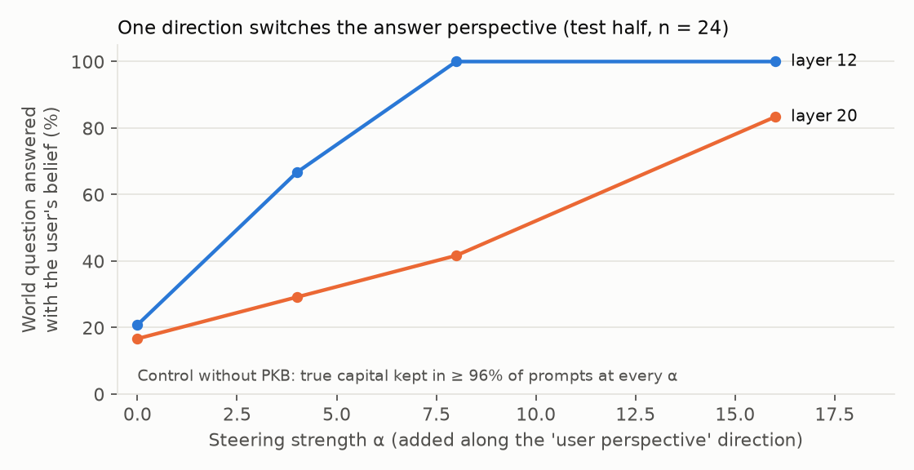

# Whose Inference?

**A mini-study of knowledge-dependent interpretation with personal knowledge bases (PKBs)**

Amrina · Saarland University (M.Sc. Educational Technology)

🚀 **Live app:** https://whose-inference.streamlit.app/ · 🌐 **Project page:** https://sayamrina.github.io/whose-inference/

When a tutor writes *"the result was significant, p = .03"*, a statistician and a student with a common misconception draw different conclusions from the same sentence. A cooperative AI system should know which reader it is talking to, predict how that reader will interpret a message, and phrase it so the intended meaning gets through. It should do this using an explicit, inspectable record of what the reader knows and believes (a PKB), and it should use that record faithfully.

This repository is a small pilot that touches each step of that pipeline. It is not a finished study: the datasets are tiny and self-made (see *Limitations*). Its purpose is to show the full chain working end to end and to find out where it breaks.

| Step | Question | Section |
|---|---|---|
| 1 | Does a reader's background knowledge change which inferences they draw? | Data |
| 2 | Can an LLM predict a specific reader's interpretation from retrieved PKB entries? | Part 2 |
| 3 | Can RSA-style simulation of the reader produce messages that avoid misreadings? | Part 3 |
| 4 | When does a model rely on the PKB vs. its parametric knowledge, where in the network, and can we steer it? | Part 4 |

## Data: knowledge-dependent NLI items and PKBs

- `data/items.jsonl`: 24 premise–hypothesis pairs about six statistics concepts with well-documented misconceptions (Greenland et al., 2016): p-values, significance vs. effect size, non-significant results, confidence intervals, correlation vs. causation, standard error vs. standard deviation. Each concept has 2 *critical* items (the label depends on the reader's knowledge) and 2 *control* items (all readers agree).
- Each item carries two labels: for a reader who **understands** the concept and for a reader who **holds the misconception**. Example: *"p = .03"* → *"there is a 97% probability that the difference is real"* is `neutral` for an informed reader and `entailment` for a reader who believes p = P(H0).
- `data/pkb_profiles.json`: three readers (*expert*, *mixed*, *misconceived*). `src/pkb.py` turns each into a small knowledge graph (`networkx`) of triples such as `(user, believes, "A statistically significant result means the effect is large")`. Retrieval links concepts mentioned in a text by keywords and returns the reader's triples about them.
- A reader's gold label is derived from the PKB: the misconception label if the PKB contains that misconception, otherwise the informed label. The *mixed* reader matters most, because the right answer then depends on *which* part of the PKB is relevant.

## Part 2: predicting a specific reader's interpretation

`src/predict.py`. GPT-4o-mini predicts the reader's label (from first-token log-probabilities) in three conditions: no PKB, the full PKB as text, and PKB triples retrieved from the graph. *Binary* = "does the reader draw the inference or not", which is the distinction that matters for misunderstandings.

| Condition (critical items, 3 readers × 12) | 3-way accuracy | Binary accuracy |
|---|---|---|
| No PKB | 0.25 | 0.42 |
| Full PKB as text | 0.28 | 0.58 |
| **Retrieved PKB triples** | **0.33** | **0.61** |
| Retrieved PKB triples, GPT-4o | 0.47 | **0.75** |

Control items: 1.00 in every condition. **Counterfactual PKB edits** (toggle one concept in the *mixed* reader's PKB): predictions for the edited concept move to the new correct label in 58% of cases (sensitivity), and predictions for all other items stay unchanged in 98.5% (specificity).

**Observations.**
- Retrieval helps more than dumping the whole PKB into the prompt.
- The edits show the model reads the right part of the PKB, but often does not follow it through. GPT-4o-mini sees *"the user believes significant means large"* and still predicts that the user will reject *"the effect is large"*. It answers from its own (correct) knowledge instead of the reader's perspective. GPT-4o does this less, especially for the misconceived reader (0.83 vs 0.50).
- For the expert, most errors are `contradiction` vs `neutral`: the model treats "unwarranted" as "false". That is partly a labelling convention, and the binary measure is unaffected by it.

## Part 3: RSA-style cooperative rephrasing

`src/rsa.py`. For each critical item where the reader is at risk (n = 18), the goal is to convey the premise without triggering the misreading.
- **literal**: the premise unchanged.
- **plain**: a generic "explain clearly" rewrite.
- **single**: one rewrite by a speaker that knows the misreading.
- **rsa**: the speaker samples 5 candidates. A *simulated listener* (the Part 2 predictor with the reader's retrieved PKB) scores each one, and the speaker keeps the best by utility = log P(understood) − λ·length. If no candidate is good enough, the reader's relevant misconceptions are made explicit to the speaker and the loop runs again.

To avoid grading the system with its own listener, evaluation uses a different model.

| Simulated listener → evaluator | literal | plain | single | rsa |
|---|---|---|---|---|
| GPT-4o-mini → GPT-4o | 0.28 | 0.28 | **0.56** | 0.50 |
| GPT-4o → GPT-4.1 | 0.17 | 0.11 | 0.17 | **0.22** |

*(share of messages the evaluator listener predicts are understood correctly)*

**Observations.**
- Telling the speaker which misreading to avoid is the biggest gain.
- Selecting among candidates with a simulated listener only helped when the listener was strong (GPT-4o), and not with GPT-4o-mini. This is consistent with Part 2: RSA can only be as good as its model of the listener.
- The two evaluators disagree a lot about the same texts. One near-identical pair of rewrites received 0.09 and 1.00 from GPT-4.1. LLM listeners are not a reliable stand-in for people. With n = 18, none of these differences should be read as significant. Testing whether the chosen messages really work needs **human comprehension data**.

## Part 4: PKB vs. parametric knowledge inside the model

`src/mech.py`, Qwen2.5-0.5B-Instruct on CPU, 48 counterfactual facts (the PKB says the user believes the capital of France is Lyon).

| Prompt | Answer follows the PKB |
|---|---|
| No PKB, "What is the capital…" | 0% |
| PKB = belief, "What does **the user believe** is the capital…" | **100%** |
| PKB = belief, "What **is** the capital…" | 17% |
| PKB = stated as fact, "What is the capital…" | 100% |

The model mostly keeps *the user's belief* separate from *the world*, which is the right behaviour for a cooperative agent. In 17% of cases, however, the belief leaks into a factual answer.

**Activation patching** (clean: PKB = Lyon; corrupted: PKB = Paris; one layer and position at a time, n = 14). The information sits at the PKB entry token until layer ~15. It is then moved to the answer position in two steps: layer 16 and layers 20–22.



**Activation steering.** A "user-perspective" direction (mean residual difference between *ask about the user* and *ask about the world*, computed on half the facts) is added at the answer position for the other half. At layer 12, α = 8 switches 100% of world questions to the user's belief. Prompts without a PKB keep the true capital (≥ 96% at every α). The same direction at layer 20 needs a much larger α.



*Note: the last-layer point in the patching plot is approximate, because the final hidden state returned by `transformers` is already normalised.*

## What this suggests for a PhD project

1. Interpretation depends on the reader. Measuring this properly needs **human NLI judgements from readers with known knowledge states**, not self-made labels (cf. human label variation, Nie et al., 2020; ChaosNLI).
2. Retrieval-grounded PKBs help prediction, but LLMs default to their own perspective. Making them *faithfully* take the reader's perspective is an open problem.
3. RSA-style generation inherits the quality of its listener model. Better, validated listener models are the bottleneck (cf. Das, Duff, Hoffmann & Demberg, 2026, *Planning Ahead with RSA*; Wang & Demberg, 2024, *RSA-Control*).
4. In a small model, the user-belief vs. world distinction is localisable and steerable. The next step is to test whether this holds in larger models and for structured PKB reasoning (cf. Jobanputra et al., 2025, *ProofTeller*).

## Limitations (please read)

- **Tiny, self-made data.** 24 items. No inter-annotator agreement and no human reader data.
- The profiles are idealised: real readers are inconsistent.
- The Part 3 evaluation uses LLM listeners. They disagree with each other, so the numbers are indicative only.
- Part 4 uses a 0.5B model and a simple fact type (capitals). The results may not transfer to larger models or richer PKBs.
- AI tools were used to support the coding process. Study design, item labels and interpretation of the results are the author's.

## Reproduce

```bash
python -m venv .venv && .venv/bin/pip install -r requirements.txt
export OPENAI_API_KEY=...                  # Parts 2-3 (about $2 in total); responses are cached
.venv/bin/python src/predict.py            # Part 2
.venv/bin/python src/rsa.py                # Part 3 (SIM_LISTENER / EVAL_LISTENER env vars)
.venv/bin/python src/mech.py               # Part 4 (CPU, ~30 min)
.venv/bin/python src/plots.py
```

## References

- Das, A., Duff, J., Hoffmann, J., & Demberg, V. (2026). Planning Ahead with RSA. AAMAS 2026. arXiv:2510.23340.
- Greenland, S., et al. (2016). Statistical tests, P values, confidence intervals, and power: a guide to misinterpretations. *European Journal of Epidemiology*, 31, 337–350.
- Jobanputra, M., et al. (2025). ProofTeller. IJCNLP-AACL 2025.
- Nie, Y., Zhou, X., & Bansal, M. (2020). What Can We Learn from Collective Human Opinions on Natural Language Inference Data? EMNLP 2020.
- Wang, Y., & Demberg, V. (2024). RSA-Control: A Pragmatics-Grounded Lightweight Controllable Text Generation Framework. EMNLP 2024.
